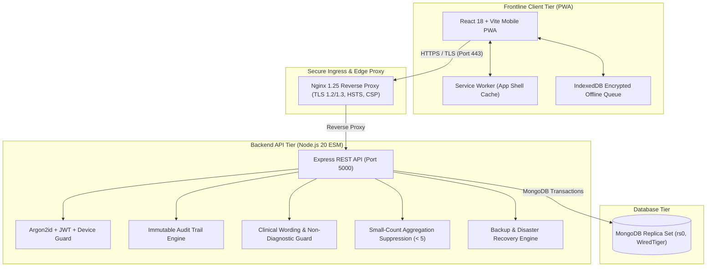

# 🏥 Aarogya-Drishti (ఆరోగ్య దృష్టి / आरोग्य दृष्टि)

> **COMMUNITY-BASED ORAL CANCER SCREENING & TRIBAL HEALTHCARE NAVIGATION PLATFORM**  
> Specially designed for the Integrated Tribal Development Agency (ITDA) Paderu, Alluri Sitharama Raju District, Andhra Pradesh.

---

### ⚠️ MANDATORY CLINICAL & SIMULATION NOTICE
```
========================================================================================
⚠️  SIMULATION SYSTEM — DEMO DATA ONLY — NOT FOR CLINICAL OR DIAGNOSTIC USE  ⚠️
========================================================================================
This software is an engineering demonstration platform designed exclusively for the
AAROHAN Hackathon 2026. All patient profiles, biometric markers, clinical images,
screening scores, and facility assignments are synthetic demo fixtures.

NO MODULE IN THIS SYSTEM IS CLINICALLY VALIDATED OR APPROVED FOR MEDICAL DIAGNOSIS.
The integrated AI engine is an unvalidated demonstration heuristic ("DEMO AI") that
provides triaging support only. It NEVER makes diagnostic conclusions, stages diseases,
or recommends curative therapies. All clinical decisions MUST be made in-person by
licensed healthcare professionals.
========================================================================================
```

---

## 🌟 Overview & Tribal Health Mission

Aarogya-Drishti bridges critical healthcare gaps in remote tribal hamlets across the Eastern Ghats of Alluri Sitharama Raju district. Tribal communities (including Konda Reddi, Bagata, Valmiki, and Gadaba habitations) face extreme geographic isolation, rugged terrain, seasonal road cutoffs during monsoons, and limited connectivity. Oral mucosal lesions and habit-associated conditions (chewing tobacco, betel nut, gudakhu) require early community screening, but secondary and tertiary hospitals are hours away.

Aarogya-Drishti equips frontline health workers (**ASHA** and **ANM** workers) with a resilient, offline-first Progressive Web App (PWA) to conduct oral screening camps, record verbatim tribal settlement landmarks, capture lesion photography with cryptographic SHA-256 integrity, and navigate patients through primary health centres (PHC/CHC) to tertiary regional hospitals (such as King George Hospital, Visakhapatnam).

---

## 🏗️ High-Level System Architecture



---

## 🔐 Core Architecture Principles

1. **Frontline Offline-First Hardening:** Frontline health workers can register patients, take screening notes, and queue records without cell connectivity. Idempotent synchronization ledgers guarantee that offline replay never creates duplicate records.
2. **Clinical Safety & Non-Diagnostic Invariants:** AI screening heuristics are strictly non-diagnostic. The system actively scans all text and templates to prevent forbidden diagnostic assertions (`cancer`, `malignant`, `stage`, `curative`).
3. **Tribal Data Sovereignty & Privacy:** Small-count suppression hides all aggregate metrics under 5 to prevent re-identification in small hamlets. Aadhaar integration is entirely simulated (`MOCK`); raw 12-digit numbers are never accepted, stored, or logged.
4. **Strict Cryptographic Immutability:** Clinical notes and lab attachments are versioned and tamper-evident using SHA-256 hashes. Prior revisions are immutable.
5. **Role-Based Capability Isolation:** 6 distinct platform roles (`system_admin`, `admin`, `medical_officer`, `specialist`, `anm`/`asha`, `patient`) enforced across 252 deduplicated endpoints with cross-hospital access denial.

---

## 🚀 Quickstart & One-Command Deployment

### Prerequisites
- [Docker](https://docs.docker.com/get-docker/) (24.0+) & Docker Compose (v2.20+)
- OpenSSL (for TLS certificate generation)

### 1. Clone & Bootstrap Environment
```bash
git clone https://github.com/organization/aarogya-drishti.git
cd aarogya-drishti

# Generate self-signed TLS certificates for development/testing
./deployment/tls/generate-certs.sh
# On Windows PowerShell:
# ./deployment/tls/generate-certs.ps1

# Copy environment configuration
cp .env.production.example .env
```

### 2. Launch Production Services with Docker
```bash
docker compose -f docker-compose.prod.yml up -d --build
```
This single command:
1. Spawns MongoDB in single-node replica set mode (`rs0`) with transactional support.
2. Builds and launches the Node.js production container with non-root security.
3. Compiles the Vite React PWA and packages it into an Nginx Alpine container.
4. Runs the hardened Nginx reverse proxy on port 443 with TLS 1.2/1.3, CSP, and HSTS.

### 3. Access the Application
- **Web UI & PWA:** [https://localhost](https://localhost)
- **API Health Probe:** [https://localhost/api/v1/health](https://localhost/api/v1/health)
- **Seed Demo Credentials:** See [docs/SETUP_GUIDE.md](docs/SETUP_GUIDE.md)

---

## 🧪 Comprehensive Verification & Test Suite

The system includes 100% automated test coverage across all 20 development phases and 77 acceptance criteria IDs:

```bash
cd server
npm test
```

### Test Suite Summary:
- **Phase 1 to 18:** 1,219 unit, regression, authorization, and clinical safety tests.
- **Phase 19 (End-to-End Integration):** 77 full acceptance tests (`tests/integrationAndE2EDemo.test.ts`).
- **Phase 20 (Deployment & Handover):**
  - `backupAndRestore.test.ts`: Automated snapshot generation, SHA-256 manifest check, disaster data loss simulation, and full data restoration.
  - `smokeTestAllModules.test.ts`: End-to-end smoke tests covering all 24 server modules.
  - `secretScanner.test.ts`: Repository-wide secret and private-key leak scanner.

---

## 📚 Complete Documentation Index

| Document | Purpose |
|---|---|
| [docs/PROJECT_REPORT.docx](docs/PROJECT_REPORT.docx) | Editable Word version of the approximately 30-page formal project report. |
| [docs/PROJECT_REPORT.md](docs/PROJECT_REPORT.md) | Approximately 30-page formal project report: problem statement, solution, features, architecture, models, technology, safeguards, and limitations. |
| [docs/PROJECT_GUIDE.md](docs/PROJECT_GUIDE.md) | Separate practical guide: local manual setup without Docker, workflows, model locations, Render configuration, and troubleshooting. |
| [docs/SETUP_GUIDE.md](docs/SETUP_GUIDE.md) | Step-by-step setup guide for clean Docker & bare-metal deployment. |
| [docs/API_DOCUMENTATION.md](docs/API_DOCUMENTATION.md) | Exhaustive REST API specification covering all 252 deduplicated endpoints. |
| [docs/ARCHITECTURE.md](docs/ARCHITECTURE.md) | Detailed technical architecture, component topologies, and security boundaries. |
| [docs/DATABASE_SCHEMA.md](docs/DATABASE_SCHEMA.md) | Complete data dictionary for all 18 collections, indices, and retention rules. |
| [AGENTS.md](AGENTS.md) | Core AI agent invariants, safety boundaries, and engineering conventions. |
| [docs/OPERATIONS_GUIDE.md](docs/OPERATIONS_GUIDE.md) | Operations runbook: backup/restore, secret rotation, replica set maintenance. |
| [docs/KNOWN_LIMITATIONS.md](docs/KNOWN_LIMITATIONS.md) | Candid disclosure of simulation boundaries and non-validated clinical aspects. |
| [docs/TRACEABILITY_MATRIX.md](docs/TRACEABILITY_MATRIX.md) | Row-level traceability spreadsheet covering all 150+ requirements and 77 acceptance IDs. |

---

## ⚖️ License & Tribal Health Program Attribution
Developed for the **AAROHAN Hackathon 2026** under the Tribal Health Initiative for ITDA Paderu. Released under the Apache 2.0 Open Source License for public healthcare demonstration.
# Daily.co Video Consultation setup

The appointment-linked consultation feature uses Daily.co's server REST API and browser SDK. Video remains blocked until credentials are configured on the backend; the app never embeds the API key in browser code.

1. Create/sign into a Daily account at [dashboard.daily.co](https://dashboard.daily.co/).
2. Create an API key in the Daily developer/API settings. Keep it private.
3. Copy `server/.env.example` to `server/.env` and set `DAILY_API_KEY`, `DAILY_DOMAIN` (the account subdomain such as `your-team.daily.co`), `MONGO_URI`, and `CLIENT_ORIGIN`.
4. Run the backend and frontend using the repository's existing scripts. Use HTTPS for deployed use and set `CLIENT_ORIGIN` to the deployed frontend origin.
5. Confirm a patient appointment and assign it to a doctor. At the appointment time, the patient enters the waiting room. The assigned doctor sends the link; the patient opens it from in-app notifications and both participants sign in.

Daily rooms are private, limited to two participants, and expired by the provider at the server-set deadline. Starting a call sets the deadline to 30 minutes; reconnecting does not reset it. The UI shows a warning in the final five minutes. The app's SMS/email adapters remain simulation-blocked, so link delivery currently uses the in-app inbox. Do not put Daily credentials in `client/.env` or any `VITE_*` variable.

Provider references: [Create a Daily room](https://docs.daily.co/reference/rest-api/rooms/create-room), [Create a Daily meeting token](https://docs.daily.co/reference/rest-api/meeting-tokens/create-meeting-token), [Daily dashboard](https://dashboard.daily.co/).

Checklist: book and confirm an appointment; enter waiting room; send/open the link; reject an unrelated account; join with assigned patient and doctor; verify camera/microphone toggles and reconnect; confirm the 25-minute warning; verify provider auto-expiry and server completion at 30 minutes; verify unused link expiry after 60 minutes; save notes and confirm a new note version preserves prior content.
