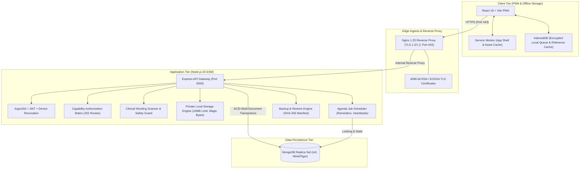

# 🏛️ Aarogya-Drishti: Complete System Architecture

> **Document Version:** 1.0.0 (Final System Handover — Phase 20)  
> **Target Environment:** ITDA Paderu Tribal Health Initiative — Alluri Sitharama Raju District  
> **Compliance Context:** AAROHAN Hackathon 2026  
> **Simulation Notice:** All data models, biometric components, and AI engines represent a simulated demonstration platform.

---

## 1. Executive Summary & Architectural Goals

Aarogya-Drishti is an offline-first, privacy-preserving healthcare navigation platform architected to screen, triage, and navigate oral mucosal conditions across remote tribal habitations in the Eastern Ghats. 

### Core Architectural Invariants:
1. **Tribal Offline Reliability:** Resilient IndexedDB offline queues guarantee full frontline screening functionality in villages lacking cellular connectivity.
2. **Idempotent Synchronization:** All frontline mutations carry client-generated UUID mutation IDs; duplicate sync attempts are strictly idempotent.
3. **Clinical Safety by Design:** The system is architecturally incapable of outputting medical diagnoses. Clinical assessment notes are decoupled from AI triage scores, and original screening records remain cryptographically immutable.
4. **Data Sovereignty & Cell Suppression:** Aggregates with fewer than 5 individuals are suppressed to eliminate re-identification risks in small tribal hamlets.
5. **Zero Public Patient Storage:** Direct static file serving is disabled; all clinical photos require token authentication and scope checks before streaming.

---

## 2. Multi-Tier System Topology

---

## 3. Detailed Component Architecture

### 3.1 Edge Ingress & TLS Termination (Nginx)
The reverse proxy terminates HTTPS using modern TLS parameters:
- **Protocols:** TLSv1.2, TLSv1.3 only (SSLv3, TLS 1.0, and TLS 1.1 explicitly rejected).
- **Ciphers:** `ECDHE-ECDSA-AES128-GCM-SHA256:ECDHE-RSA-AES128-GCM-SHA256:ECDHE-ECDSA-AES256-GCM-SHA384:ECDHE-RSA-AES256-GCM-SHA384`.
- **Security Headers:**
  - `Strict-Transport-Security: max-age=31536000; includeSubDomains` (HSTS).
  - `X-Content-Type-Options: nosniff`.
  - `X-Frame-Options: DENY`.
  - `Content-Security-Policy: default-src 'self'`.
- **Ingress Traffic Limiting:** Maximum client body size capped at 12MB (permitting 10MB binary uploads plus multipart overhead).

### 3.2 Authentication & Session Management
- **Password Storage:** Argon2id with random 16-byte salts, time cost 3, memory cost 64MB, parallelism 4.
- **Access Tokens:** Signed HMAC-SHA256 JWTs with a 15-minute expiration time.
- **Refresh Tokens:** Cryptographically random 256-bit tokens with 7-day lifespans stored as SHA-256 hashes in MongoDB.
- **Token Rotation & Reuse Detection:** Every refresh request issues a new token and invalidates the previous one. If an invalidated refresh token is presented, the entire active session family for that device is immediately revoked.
- **Account Lockout:** 5 consecutive failed login attempts trigger an automatic 5-minute cooldown.

### 3.3 Authorization & Role-Based Access Control (RBAC)
Platform privileges are governed by fine-grained capabilities mapped across 6 roles:
1. `system_admin`: Platform health, audit logging, system backups, global recovery.
2. `admin` (Hospital / District Program Coordinator): Facility management, invitations, camps, assignments.
3. `medical_officer`: Case review queue, triage assessment, result release, teleconsultation.
4. `specialist`: Tertiary referral acceptance, specialist teleconsultation notes, biopsy tracking.
5. `anm` / `asha`: Frontline patient intake, offline screening upload, camp attendance, appointment reminders.
6. `patient`: View released screening summaries, appointments, and consent preferences.

**Cross-Hospital Denial Rule:** Non-system-admin staff cannot view, edit, or search clinical data outside their assigned hospital facility or catchment mandals.

### 3.4 Offline Sync & Idempotency Pipeline
1. Frontline workers create patients, screening records, and appointments locally in IndexedDB while offline.
2. Each queued mutation receives a client-generated UUID `mutationId`.
3. When network connectivity resumes, the PWA submits `POST /api/v1/sync/batch`.
4. The server checks the `sync_ledgers` collection for each `mutationId`.
5. If the `mutationId` already exists, the server returns the cached response without re-executing business logic.

### 3.5 Clinical Safety & Non-Diagnostic Pipeline
To ensure compliance with clinical ethics and non-diagnostic mandates:
- **Prohibited Term Scanner:** An active regex scanner inspects all notification bodies, SMS templates, and AI triage summaries. Forbidden terms (`cancer`, `malignant`, `carcinoma`, `stage`, `curative`) trigger immediate rejection.
- **Decoupled Assessments:** AI triaging produces a `DEMO AI` score with a mandatory non-diagnostic disclaimer. Clinician reviews are stored in a distinct `assessments` record and are never overwritten by automated systems.
- **Immutability of Photos & Notes:** Uploaded photos and recorded consultation notes are sealed with SHA-256 digests. Any subsequent clinician edit creates a new version increment while preserving the previous revision.

### 3.6 Spatial Aggregation & Small-Count Suppression
The GIS map and administrative dashboard aggregate screening metrics across habitations:
- **Threshold Rule:** Any cell or geographic bucket containing $1 \le \text{count} < 5$ is masked to `< 5` or `[SUPPRESSED]`.
- **Empty States:** Habitations with zero data return clean empty states (`count: 0`) rather than errors.
- **Anti-Isolation:** Multi-dimensional filters (e.g., filtering by age + gender + lesion location) that isolate a single patient are suppressed.

### 3.7 Backup & Disaster Recovery Architecture
- **Engine:** Programmatic streaming engine (`backupService.ts`) and CLI scripts (`backup.ts`, `restore.ts`).
- **Structure:** Dumps all 18 MongoDB collections as newline-delimited JSON with an immutable manifest file (`backup_manifest.json`).
- **Integrity:** Every collection dump is hashed with SHA-256. The restore operation verifies the checksum of every file against the manifest before running restoration inside an ACID transaction.
- **Disaster Recovery:** Fully automated and tested by `backupAndRestore.test.ts`.

---

## 4. Network and Container Port Matrix

| Container Service | Internal Port | Edge / Host Port | Protocol | Security Scope |
|---|---|---|---|---|
| `aarogya-nginx` | 80, 443 | 80 (Redirect), 443 | HTTP -> HTTPS | Public edge, TLS terminated |
| `aarogya-server` | 5000 | Isolated | HTTP | Docker internal network only |
| `aarogya-mongodb` | 27017 | Isolated (27017 in dev) | MongoDB Wire | Replica set internal network |

---

## 5. Architectural Non-Negotiables & Guarantees
- **No Real PII:** All seed records represent fictitious personas.
- **No Direct UIDAI Link:** Aadhaar verification is an isolated mock returning `mock: true`.
- **No Telephony/Video Hardware Dependency:** Video and voice teleconsultations return `BLOCKED` stubs; text-based clinical chats are fully functional.
