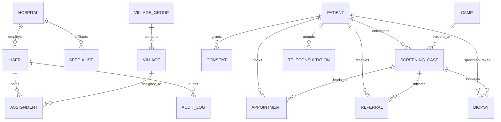

# 🗄️ Aarogya-Drishti: Complete Database Schema Dictionary

> **Platform Version:** 0.2.0 (Simulation Demo Environment)  
> **Database Engine:** MongoDB 7.0+ (WiredTiger, Single-Node Replica Set `rs0`)  
> **Total Document Collections:** 18  
> **ACID Transaction Support:** Enabled platform-wide

---

## 1. Schema Entity Relationship Overview

---

## 2. Comprehensive Collection Specifications

### 2.1 Collection: `users`
- **Module:** Module 02 (Authentication & Identity)
- **Purpose:** Stores user profiles, hashed credentials, device session identifiers, and lockout trackers.
- **Fields:**
  - `userId`: `String` (Required, Unique, Indexed)
  - `username`: `String` (Required, Unique, Indexed, Trimmed)
  - `passwordHash`: `String` (Required, Argon2id hash)
  - `role`: `Enum['system_admin', 'admin', 'medical_officer', 'specialist', 'anm', 'asha', 'patient']`
  - `fullName`: `String` (Required)
  - `phone`: `String` (Optional, E.164 format)
  - `hospitalId`: `String` (Optional, Indexed)
  - `failedLoginAttempts`: `Number` (Default 0)
  - `lockoutUntil`: `Date` (Optional)
  - `activeDevices`: `Array<{ deviceId: String, lastActive: Date, userAgent: String }>`
  - `simulation`: `Boolean` (Default true)
- **Indices:**
  - `{ userId: 1 }` (Unique)
  - `{ username: 1 }` (Unique)
  - `{ hospitalId: 1 }`

---

### 2.2 Collection: `hospitals`
- **Module:** Module 05 (Hospitals Directory)
- **Purpose:** Primary, secondary, and tertiary healthcare institutions in the catchment network.
- **Fields:**
  - `hospitalId`: `String` (Required, Unique, Indexed)
  - `name`: `String` (Required)
  - `type`: `Enum['phc', 'chc', 'area_hospital', 'district_hospital', 'tertiary_medical_college']`
  - `district`: `String` (Default: "Alluri Sitharama Raju")
  - `mandal`: `String` (Required, Indexed)
  - `specialties`: `Array<String>`
  - `totalBeds`: `Number`
  - `status`: `Enum['active', 'inactive']`
  - `simulation`: `Boolean` (Default true)
- **Indices:**
  - `{ hospitalId: 1 }` (Unique)
  - `{ mandal: 1 }`

---

### 2.3 Collection: `specialists`
- **Module:** Module 07 (Specialist Directory)
- **Purpose:** Registry of medical and surgical oncology specialists available for teleconsultations and referrals.
- **Fields:**
  - `specialistId`: `String` (Required, Unique, Indexed)
  - `name`: `String` (Required)
  - `qualification`: `String` (Required, e.g. "MS, MCh Surgical Oncology")
  - `specialty`: `Enum['head_and_neck_oncology', 'oral_maxillofacial', 'pathology', 'radiotherapy', 'general_medicine']`
  - `hospitalId`: `String` (Required, Indexed)
  - `teleconsultAvailable`: `Boolean` (Default true)
  - `availableDays`: `Array<String>`
  - `status`: `Enum['active', 'inactive']`
  - `simulation`: `Boolean` (Default true)
- **Indices:**
  - `{ specialistId: 1 }` (Unique)
  - `{ hospitalId: 1 }`
  - `{ specialty: 1, teleconsultAvailable: 1 }`

---

### 2.4 Collection: `assignments`
- **Module:** Module 08 (Health Worker Assignments)
- **Purpose:** Scopes frontline ASHA and ANM workers to specific tribal habitations.
- **Fields:**
  - `assignmentId`: `String` (Required, Unique, Indexed)
  - `workerId`: `String` (Required, Indexed)
  - `workerName`: `String` (Required)
  - `workerRole`: `Enum['asha', 'anm']`
  - `hospitalId`: `String` (Required, Indexed)
  - `assignedMandal`: `String` (Required)
  - `assignedVillages`: `Array<String>` (Village IDs)
  - `status`: `Enum['active', 'revoked']`
  - `assignedAt`: `Date` (Default: Date.now)
  - `simulation`: `Boolean` (Default true)
- **Indices:**
  - `{ assignmentId: 1 }` (Unique)
  - `{ workerId: 1, status: 1 }`
  - `{ hospitalId: 1 }`

---

### 2.5 Collection: `villages`
- **Module:** Module 09 (Tribal Census Reference)
- **Purpose:** Tribal habitations, geographic coordinates, settlement types, and transport accessibility.
- **Fields:**
  - `villageId`: `String` (Required, Unique, Indexed)
  - `villageName`: `String` (Required, Indexed)
  - `mandal`: `String` (Required, Indexed)
  - `district`: `String` (Default: "Alluri Sitharama Raju")
  - `coordinates`: `{ latitude: Number, longitude: Number }`
  - `totalPopulation`: `Number`
  - `primaryTribe`: `String` (e.g. "Konda Reddi", "Bagata", "Valmiki")
  - `connectivityStatus`: `Enum['good', 'poor', 'none']`
  - `simulation`: `Boolean` (Default true)
- **Indices:**
  - `{ villageId: 1 }` (Unique)
  - `{ mandal: 1, villageName: 1 }`

---

### 2.6 Collection: `villagegroups`
- **Module:** Module 14 (Village Groups Topology)
- **Purpose:** Clustered tribal habitations sharing health sub-centres or transport routes.
- **Fields:**
  - `groupId`: `String` (Required, Unique, Indexed)
  - `groupName`: `String` (Required)
  - `mandal`: `String` (Required, Indexed)
  - `villageIds`: `Array<String>` (Required)
  - `linkedFacilityId`: `String` (Required)
  - `simulation`: `Boolean` (Default true)
- **Indices:**
  - `{ groupId: 1 }` (Unique)
  - `{ mandal: 1 }`

---

### 2.7 Collection: `patients`
- **Module:** Module 10 (Patient Intake & Deduplication)
- **Purpose:** Demographic and tribal landmark registry (zero raw Aadhaar stored).
- **Fields:**
  - `patientId`: `String` (Required, Unique, Indexed)
  - `fullName`: `String` (Required, Indexed)
  - `gender`: `Enum['male', 'female', 'other']`
  - `ageEstimated`: `Number` (Required, 1-120)
  - `phone`: `String` (Optional, Indexed)
  - `guardianName`: `String` (Optional)
  - `villageId`: `String` (Required, Indexed)
  - `villageName`: `String` (Required)
  - `mandal`: `String` (Required, Indexed)
  - `originalAddressText`: `String` (Required, preserved verbatim)
  - `hospitalId`: `String` (Required, Indexed)
  - `registeredBy`: `String` (Required)
  - `registeredAt`: `Date` (Default: Date.now)
  - `isDuplicateCandidate`: `Boolean` (Default false)
  - `duplicateReviewStatus`: `Enum['none', 'pending_review', 'confirmed_distinct', 'merged_manual']`
  - `history`: `Array<{ timestamp: Date, action: String, performedBy: String }>`
  - `simulation`: `Boolean` (Default true)
- **Indices:**
  - `{ patientId: 1 }` (Unique)
  - `{ fullName: 1, phone: 1 }`
  - `{ villageId: 1 }`
  - `{ isDuplicateCandidate: 1, duplicateReviewStatus: 1 }`

---

### 2.8 Collection: `screeningcases`
- **Module:** Module 15 (Oral Screening Cases)
- **Purpose:** Community oral screening encounters, lesion photographs, and DEMO AI triaging.
- **Fields:**
  - `caseId`: `String` (Required, Unique, Indexed)
  - `patientId`: `String` (Required, Indexed)
  - `patientName`: `String` (Required)
  - `villageId`: `String` (Required, Indexed)
  - `hospitalId`: `String` (Required, Indexed)
  - `createdBy`: `String` (Required)
  - `status`: `Enum['pending_assignment', 'assigned', 'under_review', 'completed', 'escalated', 'referral_requested']`
  - `priority`: `Enum['routine', 'urgent', 'high_priority']`
  - `photoIds`: `Array<String>`
  - `demoAiResult`: `{ riskSupportLabel: String, confidenceScore: Number, disclaimer: String, simulationBanner: String }`
  - `assignedMoId`: `String` (Optional, Indexed)
  - `assignedMoName`: `String` (Optional)
  - `resultReleased`: `Boolean` (Default false)
  - `simulation`: `Boolean` (Default true)
- **Indices:**
  - `{ caseId: 1 }` (Unique)
  - `{ patientId: 1 }`
  - `{ assignedMoId: 1, status: 1 }`
  - `{ hospitalId: 1, status: 1 }`

---

### 2.9 Collection: `camps`
- **Module:** Module 16 (Community Screening Camps)
- **Purpose:** Planning, publishing, execution, and outcomes for field screening camps.
- **Fields:**
  - `campId`: `String` (Required, Unique, Indexed)
  - `title`: `String` (Required)
  - `hospitalId`: `String` (Required, Indexed)
  - `hospitalName`: `String` (Required)
  - `villageIds`: `Array<String>` (Required)
  - `assignedStaffIds`: `Array<String>` (Required)
  - `startDate`: `Date` (Required)
  - `endDate`: `Date` (Required)
  - `targetScreenings`: `Number` (Required)
  - `status`: `Enum['DRAFT', 'PUBLISHED', 'STARTED', 'COMPLETED', 'CANCELLED']`
  - `simulation`: `Boolean` (Default true)
- **Indices:**
  - `{ campId: 1 }` (Unique)
  - `{ hospitalId: 1, status: 1 }`

---

### 2.10 Collection: `appointments`
- **Module:** Module 17 (Patient Appointments Scheduling)
- **Purpose:** Follow-up clinical visits at PHC, CHC, or tertiary referral centers.
- **Fields:**
  - `appointmentId`: `String` (Required, Unique, Indexed)
  - `patientId`: `String` (Required, Indexed)
  - `patientName`: `String` (Required)
  - `destinationHospitalId`: `String` (Required, Indexed)
  - `destinationHospitalName`: `String` (Required)
  - `department`: `String` (Required)
  - `slotStartTime`: `Date` (Required)
  - `slotEndTime`: `Date` (Required)
  - `status`: `Enum['pending', 'confirmed', 'attended', 'cancelled', 'rescheduled']`
  - `type`: `Enum['screening_followup', 'clinical_consultation', 'biopsy_procedure', 'teleconsultation']`
  - `simulation`: `Boolean` (Default true)
- **Indices:**
  - `{ appointmentId: 1 }` (Unique)
  - `{ patientId: 1 }`
  - `{ destinationHospitalId: 1, slotStartTime: 1 }`

---

### 2.11 Collection: `biopsies`
- **Module:** Module 18 (Biopsy Specimen & Lab Findings)
- **Purpose:** Tracking pathology requisitions, transit status, and immutable histopathology reports.
- **Fields:**
  - `biopsyId`: `String` (Required, Unique, Indexed)
  - `patientId`: `String` (Required, Indexed)
  - `patientName`: `String` (Required)
  - `hospitalId`: `String` (Required, Indexed)
  - `status`: `Enum['REQUESTED', 'SPECIMEN_COLLECTED', 'IN_TRANSIT', 'PROCESSING', 'RESULT_RECEIVED', 'AMENDED']`
  - `anatomicalLocation`: `String` (Required)
  - `requestingDoctorId`: `String` (Required)
  - `labAttachment`: `{ currentFileId: String, currentSha256: String, version: Number, amendmentHistory: Array<any> }`
  - `simulation`: `Boolean` (Default true)
- **Indices:**
  - `{ biopsyId: 1 }` (Unique)
  - `{ patientId: 1 }`
  - `{ hospitalId: 1, status: 1 }`

---

### 2.12 Collection: `referrals`
- **Module:** Module 19 (Tertiary Referrals)
- **Purpose:** Inter-facility patient navigation from tribal facilities to regional cancer hospitals (e.g. KGH).
- **Fields:**
  - `referralId`: `String` (Required, Unique, Indexed)
  - `patientId`: `String` (Required, Indexed)
  - `sourceHospitalId`: `String` (Required, Indexed)
  - `destinationHospitalId`: `String` (Required, Indexed)
  - `referringDoctorId`: `String` (Required)
  - `reasonForReferral`: `String` (Required)
  - `status`: `Enum['PENDING', 'CONFIRMED', 'ATTENDED', 'CANCELLED', 'ESCALATED']`
  - `priority`: `Enum['routine', 'urgent', 'high_priority']`
  - `simulation`: `Boolean` (Default true)
- **Indices:**
  - `{ referralId: 1 }` (Unique)
  - `{ patientId: 1 }`
  - `{ destinationHospitalId: 1, status: 1 }`
  - `{ sourceHospitalId: 1 }`

---

### 2.13 Collection: `teleconsultations`
- **Module:** Module 20 (Teleconsultation Management)
- **Purpose:** Clinical video/voice stubs (marked BLOCKED) and versioned clinical discussion notes.
- **Fields:**
  - `consultationId`: `String` (Required, Unique, Indexed)
  - `patientId`: `String` (Required, Indexed)
  - `hospitalId`: `String` (Required, Indexed)
  - `assignedClinicianId`: `String` (Required, Indexed)
  - `scheduledAt`: `Date` (Required)
  - `status`: `Enum['REQUESTED', 'SCHEDULED', 'IN_PROGRESS', 'COMPLETED', 'CANCELLED']`
  - `videoAdapterStatus`: `Enum['BLOCKED', 'AVAILABLE']` (Always BLOCKED)
  - `voiceAdapterStatus`: `Enum['BLOCKED', 'AVAILABLE']` (Always BLOCKED)
  - `notes`: `Array<{ version: Number, recordedBy: String, recordedAt: Date, observations: String, sha256Hash: String }>`
  - `resultReleased`: `Boolean` (Default false)
  - `simulation`: `Boolean` (Default true)
- **Indices:**
  - `{ consultationId: 1 }` (Unique)
  - `{ assignedClinicianId: 1, status: 1 }`
  - `{ patientId: 1 }`

---

### 2.14 Collection: `auditlogs`
- **Module:** Module 03 (Security & Audit Logging)
- **Purpose:** Append-only, tamper-evident record of all security-relevant mutations and exports.
- **Fields:**
  - `logId`: `String` (Required, Unique, Indexed)
  - `action`: `String` (Required, Indexed)
  - `actorId`: `String` (Required, Indexed)
  - `actorRole`: `String` (Required)
  - `resourceType`: `String` (Required, Indexed)
  - `resourceId`: `String` (Optional)
  - `ip`: `String` (Masked / Redacted)
  - `timestamp`: `Date` (Default: Date.now, Indexed)
  - `details`: `Schema.Types.Mixed` (Sanitized)
  - `simulation`: `Boolean` (Default true)
- **Indices:**
  - `{ logId: 1 }` (Unique)
  - `{ timestamp: -1 }`
  - `{ action: 1, timestamp: -1 }`
  - `{ actorId: 1 }`

---

### 2.15 Collection: `consents`
- **Module:** Module 04 (Patient Consent Governance)
- **Purpose:** Records explicit consent for AI screening support and teleconsultation data sharing.
- **Fields:**
  - `consentId`: `String` (Required, Unique, Indexed)
  - `patientId`: `String` (Required, Indexed)
  - `purpose`: `Enum['screening_ai_analysis', 'telemedicine_share', 'data_storage']`
  - `status`: `Enum['granted', 'revoked']`
  - `witnessName`: `String` (Optional)
  - `language`: `String` (Default: "en")
  - `grantedAt`: `Date` (Default: Date.now)
  - `validUntil`: `Date` (Required)
  - `revokedAt`: `Date` (Optional)
- **Indices:**
  - `{ consentId: 1 }` (Unique)
  - `{ patientId: 1, purpose: 1, status: 1 }`

---

### 2.16 Collection: `notifications`
- **Module:** Module 12 (Notification Center)
- **Purpose:** Non-diagnostic alert queue and multi-lingual dispatch ledger.
- **Fields:**
  - `notificationId`: `String` (Required, Unique, Indexed)
  - `recipientUserId`: `String` (Required, Indexed)
  - `type`: `Enum['screening_alert', 'appointment_reminder', 'referral_update', 'system_notice']`
  - `title`: `String` (Required)
  - `body`: `String` (Required, verified non-diagnostic)
  - `read`: `Boolean` (Default false)
  - `deliveredAt`: `Date`
  - `simulation`: `Boolean` (Default true)
- **Indices:**
  - `{ notificationId: 1 }` (Unique)
  - `{ recipientUserId: 1, read: 1 }`

---

### 2.17 Collection: `recoverytickets`
- **Module:** Module 13 (Account Recovery)
- **Purpose:** Cryptographic 72-hour single-use administrator-issued password recovery tickets.
- **Fields:**
  - `ticketId`: `String` (Required, Unique, Indexed)
  - `targetUserId`: `String` (Required, Indexed)
  - `tokenHash`: `String` (Required, SHA-256)
  - `issuedBy`: `String` (Required)
  - `expiresAt`: `Date` (Required, 72 hours from creation)
  - `used`: `Boolean` (Default false)
  - `simulation`: `Boolean` (Default true)
- **Indices:**
  - `{ ticketId: 1 }` (Unique)
  - `{ targetUserId: 1, used: 1 }`
  - `{ expiresAt: 1 }` (TTL Index)

---

### 2.18 Collection: `syncledgers`
- **Module:** Module 11 (Offline Queue Batch Synchronization)
- **Purpose:** Idempotency ledger preventing replay attacks and duplicate creations from frontline offline queues.
- **Fields:**
  - `mutationId`: `String` (Required, Unique, Indexed)
  - `workerId`: `String` (Required, Indexed)
  - `deviceId`: `String` (Required)
  - `action`: `String` (Required)
  - `entityId`: `String` (Required)
  - `statusCode`: `Number` (Required)
  - `responsePayload`: `Schema.Types.Mixed`
  - `syncedAt`: `Date` (Default: Date.now)
- **Indices:**
  - `{ mutationId: 1 }` (Unique)
  - `{ workerId: 1, syncedAt: -1 }`

---

### 2.19 Collection: `aiscreenings`
- **Module:** AI Engine (Multi-Disease Oral Screening: Modules A, B, C & Consolidated Report)
- **Purpose:** Stores multi-factor AI oral screening assessments combining mucosal lesion models, multi-label dental examination, and patient-reported risk history.
- **Fields:**
  - `screeningId`: `String` (Required, Unique, Indexed, e.g. `AI-SCR-A1B2C3D4`)
  - `patientId`: `String` (Required, Indexed)
  - `performedBy`: `Object` (`{ userId, username, role, fullName }`)
  - `hospitalId`: `String` (Optional, Indexed)
  - `label`: `String` (Top-level Module A predicted label, e.g. `normal`, `opmd`)
  - `confidence`: `Number` (Top-level confidence score)
  - `probabilities`: `Map<String, Number>` (Softmax probability distribution)
  - `referToSpecialist`: `Boolean` (Consolidated referral flag)
  - `modelVersion`: `String` (Model identifier)
  - `source`: `Enum['server', 'on-device']`
  - `imageRef`: `String` (File reference in private storage)
  - `imageQuality`: `Object` (`{ ok, reason, blurScore, brightness }`)
  - `moduleA`: `Object` (Structured Mucosal Lesion analysis with configurable classes)
  - `moduleB`: `Object` (`{ findings: Array<{ label, probability, threshold, flagged }>, seeDentistRecommended, modelVersion, source, imageRef }`)
  - `moduleC`: `Object` (`{ answers: IRiskQuestionnaireAnswers, score: Number, level: "LOW"|"MODERATE"|"HIGH", flaggedSymptoms: String[], flaggedHabits: String[], reportedByPatient: Boolean, rationale: String, clinicalValidationRequired: Boolean }`)
  - `combinedRecommendation`: `Object` (`{ referToSpecialist: Boolean, seeDentist: Boolean, triageCategory: "URGENT_SPECIALIST"|"DENTAL_MONITOR"|"ROUTINE", badgeColor: "RED"|"AMBER"|"GREEN", triggerModules: String[], advice: String }`)
  - `clinicianReview`: `Object` (`{ status: "PENDING"|"CONFIRMED"|"OVERRIDDEN", reviewedBy: String, reviewerName: String, finalImpression: String, notes: String, reviewedAt: Date }`)
  - `serverVerification`: `Object` (`{ label, confidence, probabilities, dentalFindings, verifiedAt: Date, matchesOnDevice: Boolean }`)
  - `consentGiven`: `Boolean` (Mandatory true)
  - `consentTimestamp`: `Date`
  - `syncStatus`: `Enum['SYNCED', 'PENDING_SYNC']` (Indexed)
  - `clientId`: `String` (Required, Unique, Indexed UUID for offline deduplication)
- **Indices:**
  - `{ screeningId: 1 }` (Unique)
  - `{ clientId: 1 }` (Unique)
  - `{ patientId: 1, createdAt: -1 }`
  - `{ hospitalId: 1, createdAt: -1 }`
  - `{ syncStatus: 1 }`

---

### 2.19 Collection Schema Updates: `users` (Verification & Initial Password)
- **Module:** Module 02 & Module 03 (Identity & Hospital Admin)
- **Enhanced Fields:**
  - `mustChangePassword`: `Boolean` (Default `false`). Flagged `true` for accounts generated by Administrators/Hospital Managers.
  - `verificationStatus`: `Enum['pending_verification', 'verified', 'rejected']` (Default `'verified'`). Set to `'pending_verification'` when doctor accounts are created.
  - `verificationDetails`: `Object`
    - `verifiedBy`: `String` (User ID of verifying Hospital Manager).
    - `verifiedAt`: `Date` (Timestamp of verification approval).
    - `councilRegistrationNumber`: `String` (State Dental / Medical Council ID).
    - `specialization`: `String` (e.g. Oral Medicine, Maxillofacial Surgery).
    - `experienceYears`: `Number`.
    - `qualificationDocuments`: `Array<{ documentId: String, documentType: String, fileUrl: String, sha256Hash: String, uploadedAt: Date }>` (Uploaded certificates stored in private storage).
    - `rejectionReason`: `String` (Optional explanation if rejected).
- **Indices:**
  - `{ verificationStatus: 1 }`
  - `{ hospitalId: 1, role: 1, verificationStatus: 1 }`

### 2.20 Collection Schema Updates: `teleconsultations` (Urgent Triage Pipeline)
- **Module:** Module 13 (Teleconsultation)
- **Enhanced Fields:**
  - `isUrgent`: `Boolean` (Default `false`, Indexed). Marks case for high-priority emergency triage.
  - `urgencyDetails`: `Object`
    - `urgencyReason`: `String` (e.g. rapidly enlarging ulcer, active bleeding, severe trismus).
    - `symptomDurationDays`: `Number` (Duration of acute symptom in days).
    - `doctorNotificationDispatched`: `Boolean` (Records alert dispatch to on-call clinician).
    - `urgentStatus`: `Enum['REQUESTED', 'ACKNOWLEDGED', 'TRIAGED', 'RESOLVED']` (Triage progress tracker).
    - `acknowledgedBy`: `String` (Clinician user ID).
    - `acknowledgedAt`: `Date`.
    - `emergencyInstructions`: `Array<String>` (Pre-transit first aid and interim palliative instructions).
    - `hospitalEmergencyContact`: `String` (108 Free Emergency Ambulance & CHC Casualty Desk number).
- **Indices:**
  - `{ isUrgent: 1, "urgencyDetails.urgentStatus": 1 }`
  - `{ hospitalId: 1, isUrgent: 1, createdAt: -1 }`
