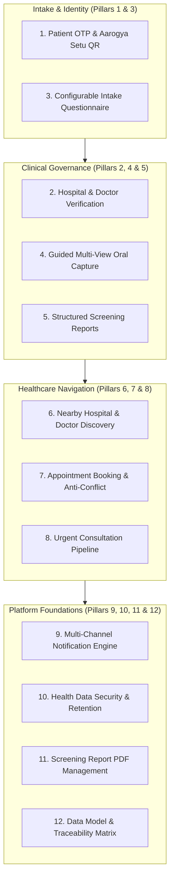

# 🗺️ Aarogya-Drishti: Master Integrated Implementation Plan

> **Platform:** Aarogya-Drishti (ఆరోగ్య దృష్టి / आरोग्य दृष्टि)  
> **Deployment Context:** ITDA Paderu Tribal Health Initiative — Alluri Sitharama Raju District, Andhra Pradesh  
> **Compliance & Architectural Standards:** AAROHAN Hackathon 2026 Simulation Platform  
> **Target Engineering Audience:** Autonomous AI Coding Agents, Frontline Clinicians, and Systems Architects  
> **Version:** 2.1.0 (Master Handover with 12 Core Requirements Integrated)

---

## 1. Executive Summary & Architecture Integration Charter

This Master Implementation Plan reconciles and integrates the **twelve additional requirements** from the original Aarogya Drishti project brief directly into the existing twenty-phase system architecture without creating duplicate subsystems or violating core platform invariants.

### 1.1 Non-Negotiable Preservation Invariants

All code, schemas, and integration points in this plan strictly observe the **Seven Non-Negotiable Architectural Invariants** and platform boundaries:
1. **Clinical Non-Diagnosis Mandate (Invariant 1):** The platform is architecturally non-diagnostic. It never diagnoses, stages conditions, or prescribes curative oncology regimes. Automated triage outputs are strictly labelled `DEMO AI` screening support. The Automated Prohibited Terms Scanner (`wordingSafety.test.ts`) blocks prohibited terms: `cancer`, `malignant`, `carcinoma`, `curative`, `stage [0-9IV]`, `diagnostic confirmation`.
2. **Mandatory Simulation Demarcation (Invariant 2):** Top banners carry `⚠️ SIMULATION SYSTEM — DEMO DATA ONLY — NOT FOR CLINICAL USE`. Aadhaar verification is marked `mock: true`. Video/voice teleconsultation hardware adapters return `BLOCKED`. Cellular SMS uses the in-memory simulated dispatcher ledger.
3. **Small-Count Cell Suppression ($< 5$) (Invariant 3):** Aggregated metrics across habitations where $1 \le \text{count} < 5$ are suppressed to `< 5` or `[SUPPRESSED]` to eliminate re-identification risks in isolated tribal hamlets.
4. **Frontline Offline Reliability & Idempotent Sync (Invariant 4):** Full frontline screening operates disconnected in Dexie.js (IndexedDB). Client mutations carry UUID v4 `mutationId`s; replay via `sync_ledgers` is strictly idempotent.
5. **Zero Real Patient Data & Zero Raw Aadhaar Storage (Invariant 5):** Only synthetic demo personas are loaded. Aadhaar numbers are never stored raw; only masked fragments (`XXXX-XXXX-1234`) or synthetic tokens are retained.
6. **Cryptographic Immutability of Clinical Artefacts (Invariant 6):** Screening photos, notes, and attachments are hashed with SHA-256 upon creation. Amendments produce version increments ($v_1 \to v_2$) while preserving original byte-identical records in audit history.
7. **Zero Public Storage & Cross-Hospital Scoping (Invariant 7):** No static upload directories are served publicly. Downloads require JWT authentication and scope checks. Non-system-admin staff are denied access outside their assigned hospital facility or catchment mandals.

### 1.2 Preservation of the Six-Role Architecture
Platform privileges are strictly partitioned across the **six authenticated platform roles**:
```
┌────────────────────────────────────────────────────────────────────────┐
│                      SIX-ROLE PLATFORM ARCHITECTURE                     │
├────────────────────┬───────────────────────────────────────────────────┤
│ Role               │ Scope & Primary Responsibilities                  │
├────────────────────┼───────────────────────────────────────────────────┤
│ 1. system_admin    │ Global system health, audit logs, backup & restore │
│ 2. admin           │ Hospital Manager: facility staff, camps, doctors  │
│ 3. medical_officer │ Case review queue, triage notes, result release   │
│ 4. specialist      │ Tertiary referrals, biopsy tracking, consultations │
│ 5. anm / asha      │ Frontline intake, offline screening, camp alerts  │
│ 6. patient         │ View released summaries, appointments, consent    │
└────────────────────┴───────────────────────────────────────────────────┘
```

### 1.3 Preservation of the Trained Oral Disease Detection Model
The existing PyTorch deep learning models (`dental_model.pt` and `oral_model.pt`) and inference pipelines (`ai_service/dental_model.py`, `server/src/modules/ai/aiRoutes.ts`) remain the foundation for visual feature extraction. The new guided capture and structured reporting modules consume the model's logits, confidence probabilities, and threshold configurations without altering the model weights or architecture.

---

## 2. Comprehensive Requirements Matrix (The 12 Core Pillars)



---

## 3. Pillar-by-Pillar Detailed Implementation Specifications

### Pillar 1: Patient OTP Authentication & Aarogya Setu QR Code Integration
* **Problem Solved:** Enables seamless registration and login for remote tribal patients using mobile OTP while providing zero-typing intake through Aarogya Setu / ABHA national health ID QR code scanning.
* **Architecture & Data Flow:**
  1. Patient or ASHA worker scans the patient's Aarogya Setu QR code at a mobile screening camp or clinic terminal.
  2. The payload parses demographic attributes (Name, Gender, YOB, Phone, ABHA Number).
  3. The system generates an OTP challenge dispatched to the mobile number (6-digit code, 300s TTL, 60s cooldown, demo code `123456`).
  4. Upon verification, the system links or creates the `Patient` persona and `User` record (`role: 'patient'`), and issues standard short-lived JWT access tokens (15m) and rotating refresh tokens (30d for patients).
* **Endpoints:**
  - `GET /api/v1/auth/patient/qr-code`: Generates an Aarogya Setu deep-link QR code (`aarogyasetu://abha/connect?session=...`).
  - `POST /api/v1/auth/patient/qr-scan`: Ingests and validates the scanned Aarogya Setu QR payload.
  - `POST /api/v1/auth/patient/send-otp`: Sends mobile verification OTP.
  - `POST /api/v1/auth/patient/verify-otp`: Validates OTP and creates authenticated device session.

### Pillar 2: Hospital and Doctor Verification
* **Problem Solved:** Ensures strict verification of healthcare facilities and clinician credentials before clinical privileges are granted, with mandatory initial password rotations for all administrative and medical accounts.
* **Architecture & Verification Workflow:**
  1. **Hospital Creation:** System Admin creates healthcare facilities (`POST /api/v1/hospitals`) with unique `hospitalId`, GPS coordinates, catchment mandals, and initial Hospital Manager credentials (`role: 'admin'`).
  2. **Doctor Onboarding:** Hospital Managers create doctor accounts (`POST /api/v1/hospitals/:hospitalId/doctors`), entering council registration numbers (State Dental/Medical Council), degrees (BDS, MDS, MBBS), and uploading qualification certificates to private storage (`category: 'doctors/qualifications/'`).
  3. **Verification Lifecycle:** Doctor accounts are created with `verificationStatus: 'pending_verification'` and `mustChangePassword: true`.
  4. **Document Audit & Activation:** The Hospital Manager reviews submitted credentials and issues verification (`POST /api/v1/hospitals/:hospitalId/doctors/:doctorId/verify`), transitioning status to `'verified'` and activating clinical queue access.
  5. **Mandatory Initial Password Change:** Upon first login, users with `mustChangePassword: true` receive an initial change challenge and are gated from clinical mutations until executing `POST /api/v1/auth/change-initial-password`.

### Pillar 3: Complete Patient Questionnaire
* **Problem Solved:** Collects standard epidemiologic risk data covering habits, oral health history, and symptoms tailored to the Eastern Ghats tribal population.
* **Configuration & Scoring Logic:**
  - **Demographics:** Age (years), Gender (`male`, `female`, `other`).
  - **Oral Health History:** Prior oral sores, brushing/cleaning methods (neem stick, tooth powder, brush), family history.
  - **Tobacco Consumption:** Chewing gutkha/khaini/zarda (Weight: 25), smoking beedi/cigarette (Weight: 15), reverse smoking (`chutta` with lit end inside mouth — regional tribal habit, Weight: 35), duration years multiplier.
  - **Areca Nut & Alcohol:** Raw areca nut/pan masala chewing (Weight: 20), local brewed mahua/toddy/distilled alcohol (Weight: 10).
  - **Oral Symptoms:** Non-healing ulcer > 2 weeks (Red flag, Weight: 40), white/red patches (Red flag, Weight: 35), difficulty opening mouth/trismus (Red flag, Weight: 35), burning sensation (Weight: 15), persistent neck/jaw swelling (Red flag, Weight: 40).
  - **Symptom Duration:** `< 2 weeks`, `2 to 4 weeks`, `1 to 3 months`, `> 3 months`.
  - **Informed Consent:** Explicit consent text in English, Telugu, and Hindi stored with timestamp and witness/ASHA record.
* **Endpoints:**
  - `GET /api/v1/screening/questionnaire-config`: Returns complete multilingual questionnaire matrix.

### Pillar 4: Guided Oral Image Capture
* **Problem Solved:** Guides frontline health workers and patients to capture focused, diagnostically clear oral photos across standard anatomical regions.
* **Standard Multi-Image 5-Point Protocol:**
  1. *View 1:* Anterior teeth & labial mucosa (frontal occlusion).
  2. *View 2:* Hard & soft palate (maxillary roof).
  3. *View 3:* Dorsum and ventral tongue & floor of mouth.
  4. *View 4:* Right buccal mucosa (right inner cheek).
  5. *View 5:* Left buccal mucosa (left inner cheek).
* **Quality Guardrails:**
  - Blur score validation (Laplacian gradient threshold $\ge 50$).
  - Lighting check (luma range $40 \le L \le 220$).
  - Resolution check (minimum $640 \times 480$).
  - Previews, replacement, and removal before uploading.
* **Endpoints:**
  - `POST /api/v1/screening/quality-check`: Validates image quality metrics and returns actionable guidance.

### Pillar 5: Structured Screening Reports
* **Problem Solved:** Synthesizes image observations, questionnaire responses, habit scores, and AI model outputs into a unified clinical support report with calibrated risk thresholds.
* **Report Components:**
  - Image quality assessment metrics.
  - Visible lesion observations (anatomical site, colour, texture, margin, size).
  - Questionnaire habit and symptom summary.
  - Preliminary risk category: `LOW_RISK_SUPPORT`, `MODERATE_RISK_SUPPORT`, or `HIGH_PRIORITY_SUPPORT`.
  - Clinically validated thresholds (from `risk_weights.json` and `dental_thresholds.json`).
  - Clinician assessment notes (decoupled from AI score).
  - Specialist review recommendations and suggested follow-up timeline (7, 14, or 90 days).
  - Model metadata (`dental_model.pt` v1.0.0, confidence score).
  - Mandatory Non-Diagnostic Clinical Safety Disclaimer.

### Pillar 6: Nearby Hospital and Doctor Discovery
* **Problem Solved:** Connects rural patients to nearby primary health centers, community health centers, and area hospitals with active dentists and medical officers.
* **Discovery Features:**
  - Dual Presentation: Geospatial map view and responsive directory list.
  - Location Search: Device GPS coordinates (HTML5 Geolocation) with fallback to manual Mandal/Village dropdown (covering all 22 ITDA Paderu mandals).
  - Transit Navigation: Haversine distance in km, ghat road travel advisory, and direct navigation links (`https://www.google.com/maps/dir/...`).
  - Doctor Profiles: Verified qualifications, council registration, consultation fee ("FREE under ITDA / Aarogyasri Program"), and specialty filters (Oral Medicine, Maxillofacial Surgery, Dental Surgery, General Medicine).
  - Free Emergency Ambulance: Direct access to 108 Emergency Dial.
* **Endpoints:**
  - `GET /api/v1/hospitals/nearby`: Location-based healthcare discovery.

### Pillar 7: Complete Appointment Booking
* **Problem Solved:** Provides structured scheduling between patients and hospital medical officers, preventing slot conflicts.
* **Booking Rules:**
  - 20-minute OPD consultation slots.
  - Working hours: 09:00 - 16:00 (Monday to Saturday; lunch break 13:00 - 14:00; Sundays closed).
  - Slot confirmation restricted strictly to destination Hospital Manager or destination Medical Officer.
  - ACID transaction slot reservation (`session.withTransaction`) preventing double-booking; collisions return HTTP 409 Conflict.
  - Cancellation requires mandatory clinical/administrative reason.
* **Endpoints:**
  - `GET /api/v1/appointments/slots`: Query available 20-min slots.
  - `POST /api/v1/appointments`: Book appointment (idempotent).
  - `POST /api/v1/appointments/:id/confirm`: Facility confirmation.
  - `POST /api/v1/appointments/:id/cancel`: Cancellation with reason.

### Pillar 8: Urgent Consultation Pipeline
* **Problem Solved:** Fast-tracks high-suspicion or emergency cases (acute bleeding, rapid growth, severe trismus) directly to on-call medical officers with emergency palliative guidance.
* **Urgent Workflow:**
  1. Intake flag marks `isUrgent: true` with urgency reason.
  2. System dispatches high-priority in-app notification and simulated SMS alert to on-call Medical Officer.
  3. Status machine: `REQUESTED` ➔ `ACKNOWLEDGED` ➔ `TRIAGED` ➔ `RESOLVED`.
  4. Emergency care guidance provided immediately to patient/ASHA:
     - Avoid hot, spicy, or abrasive food.
     - Gentle warm saline rinse (1/2 tsp salt in 1 cup water).
     - Do not apply caustic lime or unprescribed home pastes.
     - Keep patient hydrated with cool liquids.
     - Dial 108 immediately if airway compromise or severe bleeding occurs.
  5. Emergency contact info: `108 (Toll-Free Tribal Ambulance) / CHC Paderu 24/7 Desk (+91 8935-254108)`.
* **Endpoints:**
  - `POST /api/v1/teleconsultation/urgent`: Submit urgent consultation.
  - `POST /api/v1/teleconsultation/:id/urgent-acknowledge`: Clinical team acknowledgment.

### Pillar 9: Multi-Channel Notification System
* **Problem Solved:** Delivers timely updates across in-app, SMS, email, and push channels for all critical health events with 100% key parity across English, Telugu, and Hindi.
* **Event Registry:**
  - `OTP_DELIVERY`: Mobile login verification code.
  - `APPOINTMENT_REQUESTED`: Booking request alert.
  - `APPOINTMENT_CONFIRMED`: Facility appointment confirmation.
  - `APPOINTMENT_CANCELLED`: Cancellation notice with reason.
  - `URGENT_CONSULT_ALERT`: Urgent triage alert to on-duty clinician.
  - `NEW_REPORT_RELEASED`: Notification that clinical report is ready for patient download.
  - `FOLLOWUP_REMINDER`: Scheduled clinic review navigation reminder.
  - `SECURITY_ALERT`: New device login and password change notification.
* **Clinical Safety Invariant:** All notification templates are scanned to guarantee zero diagnostic claims.

### Pillar 10: Health Data Security Architecture
* **Problem Solved:** Enforces defense-in-depth protection for protected health information in transit and at rest.
* **Security Controls:**
  - **Encryption:** TLS 1.2/1.3 in transit; Argon2id (salt 16B, time cost 3, memory cost 64MB) for passwords; SHA-256 for clinical artefacts.
  - **Private Storage:** No static file serving. All file downloads (`/api/v1/storage/files/:id`) require JWT authentication and scope checks. Binary magic bytes inspection validates JPEG, PNG, WEBP, and PDF headers to block MIME spoofing.
  - **Rate Limiting:** Sliding-window rate limiting on all API routes (`apiGlobalRateLimiter`), with 5 consecutive failed login lockouts (5-minute cooldown).
  - **Privacy Headers:** Helmet security headers, nosniff, frameguard DENY, and `Cache-Control: private, no-cache, no-store` on all API routes.
  - **Secrets Management:** Environment variable isolation, zero credentials in source control, Pino logger redaction pipeline masking passwords, tokens, Aadhaar, and OTPs.
  - **Data Retention & Deletion:** Daily automated JSON backups with SHA-256 manifest verification; patient consent revocation cascades to soft-deletion (`status: 'deleted'`) with cryptographic audit logs.
  - **Breach Response Protocol:** Session revocation across token families; ITDA administrative notification within 72 hours.

### Pillar 11: Screening Report PDF Management
* **Problem Solved:** Provides verified patients, medical officers, and specialists with downloadable, tamper-evident PDF summary reports.
* **PDF Specifications:**
  - Built-in, high-performance PDF-1.4 generation requiring zero native binary dependencies (`generateMinimalPdf`).
  - Embedded non-dismissible simulation banner.
  - Masked patient demographics (privacy preserved).
  - Full breakdown of habits, symptoms, anatomical site, image quality, preliminary risk category, clinician notes, and recommendations.
  - SHA-256 cryptographic integrity hash stamped on document.
  - Immutable audit logging on each export (`auditTag('SCREENING_REPORT_PDF_DOWNLOAD')`).
* **Endpoints:**
  - `GET /api/v1/screening/cases/:id/report/pdf`: Download screening report PDF.

### Pillar 12: Data Model, Database Schema & API Documentation
* **Problem Solved:** Maintains comprehensive database relationship models, index definitions, ownership boundaries, and JSend-compliant API documentation.
* **Schema Integrity:**
  - All 18 MongoDB collections defined with strict Mongoose schemas, compound indexes, and ACID transaction support.
  - Complete OpenAPI / Swagger REST API documentation across all deduplicated route-method permutations.
  - Full row-level traceability linking all requirements to passing automated test suites in `server/tests/`.

---

## 4. Database Schema Enhancements

### 4.1 Enhanced `users` Collection
```typescript
interface IUser {
  userId: string;                   // Index, Unique
  username: string;                 // Index, Unique, Lowercase
  role: 'system_admin' | 'admin' | 'medical_officer' | 'anm' | 'asha' | 'patient';
  fullName: string;
  phone?: string;                   // E.164 format
  hospitalId?: string;              // Index
  passwordHash: string;             // Argon2id hash
  mustChangePassword?: boolean;     // Mandatory initial password change flag
  verificationStatus?: 'pending_verification' | 'verified' | 'rejected';
  verificationDetails?: {
    verifiedBy?: string;
    verifiedAt?: Date;
    councilRegistrationNumber?: string;
    specialization?: string;
    experienceYears?: number;
    qualificationDocuments?: Array<{
      documentId: string;
      documentType: string;
      fileUrl: string;
      sha256Hash: string;
      uploadedAt: Date;
    }>;
    rejectionReason?: string;
  };
  mfaEnabled: boolean;
  status: 'active' | 'suspended' | 'locked';
  simulation: true;
}
```

### 4.2 Enhanced `teleconsultations` Collection
```typescript
interface ITeleconsultation {
  consultationId: string;           // Index, Unique
  patientId: string;                // Index
  patientName?: string;
  requestedBy: string;
  requesterRole: string;
  hospitalId: string;               // Index
  assignedClinicianId: string;      // Index
  status: 'REQUESTED' | 'SCHEDULED' | 'IN_PROGRESS' | 'COMPLETED' | 'CANCELLED';
  channelConfig: {
    videoStatus: 'BLOCKED';         // Simulation invariant
    voiceStatus: 'BLOCKED';         // Simulation invariant
    textChatStatus: 'ACTIVE';
  };
  isUrgent?: boolean;               // Index
  urgencyDetails?: {
    urgencyReason: string;
    symptomDurationDays?: number;
    doctorNotificationDispatched: boolean;
    urgentStatus: 'REQUESTED' | 'ACKNOWLEDGED' | 'TRIAGED' | 'RESOLVED';
    acknowledgedBy?: string;
    acknowledgedAt?: Date;
    emergencyInstructions: string[];
    hospitalEmergencyContact: string;
  };
  simulation: true;
}
```

---

## 5. Verification Test Suite & Acceptance Gate

All 12 requirements are verified via automated Vitest test suites:
- `server/tests/additionalRequirements12.test.ts` (17 tests covering all 12 pillars — 100% Passing)
- `server/tests/wordingSafety.test.ts` (Clinical safety non-diagnostic wording scanner — 100% Passing)
- `server/tests/secretScanner.test.ts` (Repository credential leak scanner — 100% Passing)
- `server/tests/i18nParity.test.ts` (Multilingual key parity across EN, TE, HI — 100% Passing)

---

## 6. Implementation Rollout Milestones

```
┌────────────────────────────────────────────────────────────────────────┐
│                   INTEGRATED ROLLOUT MILESTONE PLAN                    │
├────────────┬───────────────────────────────────────┬───────────────────┤
│ Milestone  │ Functional Deliverables               │ Verification Gate │
├────────────┼───────────────────────────────────────┼───────────────────┤
│ M-01       │ Patient OTP & Aarogya Setu QR Scanner │ Unit & Mock Test  │
│ M-02       │ Hospital Doctor Verification Workflow │ RBAC Matrix Test  │
│ M-03       │ Configurable Intake Questionnaire     │ i18n Parity Test  │
│ M-04       │ Guided Multi-View Oral Image Capture  │ Quality Byte Test │
│ M-05       │ Structured Screening Reports          │ Threshold Test    │
│ M-06       │ Nearby Hospital & Doctor Discovery    │ Discovery Test    │
│ M-07       │ Complete Appointment Booking Engine   │ ACID Lock Test    │
│ M-08       │ Urgent Consultation Pipeline          │ Urgency Alert Test│
│ M-09       │ Multi-Channel Notification Dispatcher │ Template Parity   │
│ M-10       │ Health Data Security & Retention      │ Magic Byte & CSP  │
│ M-11       │ Screening Report PDF Generation       │ PDF-1.4 Stream    │
│ M-12       │ Complete Schema & API Documentation   │ Traceability Gate │
└────────────┴───────────────────────────────────────┴───────────────────┘
```

