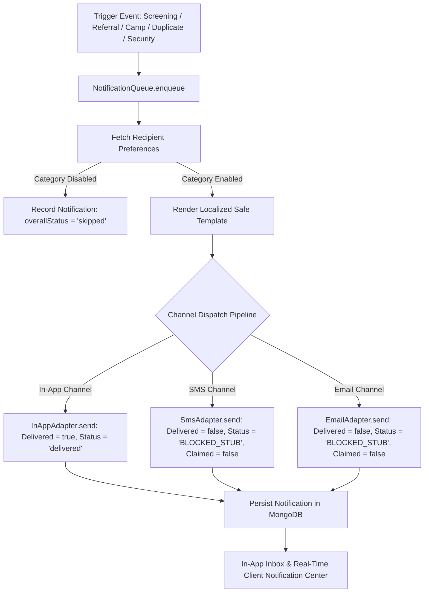

# Aarogya Drishti — Phase 5: Notification Core Implementation Report

**Author**: Senior Full-Stack Health-Tech Engineer  
**Status**: Completed & Verified  
**Date**: 2026-10-31  
**Compliance Standard**: Clinical Safety Guardrails & Truth in Advertising / Sandbox Delivery Invariant

---

## 1. Executive Summary

Phase 5 introduces the **Notification Core** to the **Aarogya Drishti** tele-screening platform. The notification subsystem provides reliable, in-app event communication for frontline healthcare workers (ASHAs, ANMs, Medical Officers) and tribal patients, while enforcing strict **Truth-in-Delivery** and **Clinical Safety** guarantees.

### Key Engineering Invariants Enforced:
1. **SMS & Email Adapters are BLOCKED Stubs**: In simulation and sandbox mode, no external telecommunications carrier or SMTP transport is claimed. The SMS and Email adapters explicitly return `status: 'BLOCKED_STUB'`, `delivered: false`, and `claimed: false`.
2. **Clinical Safety Guarantee**: Notification templates contain **ZERO clinical diagnostic claims, staging assertions, or treatment promises**. Visual oral observations are strictly represented as screening indicators requiring clinical specialist consultation.
3. **i18n Parity**: 100% dictionary key parity across English (`en.json`), Telugu (`te.json`), and Hindi (`hi.json`).
4. **Recipient Preferences**: Fine-grained opt-ins for delivery channels (In-App, SMS, Email), category subscriptions (Screening, Referral, Camp, Duplicate Alert, Security Alert, Advisory), and language preferences.
5. **Auditable Channel Delivery Tracking**: Every notification record stores an array of per-channel delivery attempts with timestamps, exact status codes, and reason explanations.

---

## 2. Core Architecture & Components



---

## 3. Subsystem Implementation Details

### 3.1 SMS and Email BLOCKED Stubs (`server/src/modules/notification/adapters/`)
Under no circumstances does Aarogya Drishti simulate phantom delivery to external telecom networks.

- **`SmsAdapter`** ([smsAdapter.ts](file:///c:/Users/YTC%20CHINTAPALLI/Desktop/AAROGYA-DRISHTI/server/src/modules/notification/adapters/smsAdapter.ts)):
  ```typescript
  export class SmsAdapter {
    static readonly isBlockedStub = true;
    static readonly gatewayConfigured = false;

    static async send(recipientPhone: string, message: string): Promise<SmsDispatchResult> {
      return {
        channel: 'sms',
        delivered: false,
        status: 'BLOCKED_STUB',
        recipientPhone: recipientPhone || 'NOT_PROVIDED',
        reason: 'SMS delivery is a BLOCKED stub in simulation/sandbox mode. No SMS gateway or telecommunications delivery is claimed.',
        claimed: false,
        dispatchedAt: new Date().toISOString(),
      };
    }
  }
  ```
- **`EmailAdapter`** ([emailAdapter.ts](file:///c:/Users/YTC%20CHINTAPALLI/Desktop/AAROGYA-DRISHTI/server/src/modules/notification/adapters/emailAdapter.ts)):
  ```typescript
  export class EmailAdapter {
    static readonly isBlockedStub = true;
    static readonly transportConfigured = false;

    static async send(recipientEmail: string, subject: string, message: string): Promise<EmailDispatchResult> {
      return {
        channel: 'email',
        delivered: false,
        status: 'BLOCKED_STUB',
        recipientEmail: recipientEmail || 'NOT_PROVIDED',
        reason: 'Email delivery is a BLOCKED stub in simulation/sandbox mode. No SMTP transport or delivery is claimed.',
        claimed: false,
        dispatchedAt: new Date().toISOString(),
      };
    }
  }
  ```
- **`InAppAdapter`** ([inAppAdapter.ts](file:///c:/Users/YTC%20CHINTAPALLI/Desktop/AAROGYA-DRISHTI/server/src/modules/notification/adapters/inAppAdapter.ts)):
  - Persists real in-app notifications for authenticated users.
  - Returns `delivered: true` and `status: 'delivered'`.

---

### 3.2 Clinical Safety Templates Registry (`server/src/modules/notification/templates.ts`)
All templates adhere to non-diagnostic screening language verified against the Clinical Safety Guardrail scanner:

| Template ID | Category | English Title | Telugu Title | Hindi Title |
| :--- | :--- | :--- | :--- | :--- |
| `SCREENING_RECORDED` | `screening` | Oral Health Screening Recorded | నోటి ఆరోగ్య స్క్రీనింగ్ నమోదు చేయబడింది | मौखिक स्वास्थ्य स्क्रीनिंग दर्ज की गई |
| `REFERRAL_DISPATCHED` | `referral` | Clinical Referral Consultation Requested | క్లినికల్ రిఫరల్ సంప్రదింపు అభ్యర్థించబడింది | नैदानिक रेफरल परामर्श का अनुरोध किया गया |
| `CAMP_SCHEDULED` | `camp` | Oral Screening Camp Scheduled | నోటి స్క్రీనింగ్ శిబిరం షెడ్యూల్ చేయబడింది | मौखिक स्क्रीनिंग शिविर निर्धारित किया गया |
| `DUPLICATE_ALERT` | `duplicate_alert` | Duplicate Patient Intake Review Required | సారూప్య రోగి నమోదు సమీక్ష అవసరం | समान रोगी पंजीकरण समीक्षा आवश्यक |
| `SECURITY_ALERT` | `security` | New Device Authentication Session | కొత్త పరికర ప్రమాణీకరణ సెషన్ | नया उपकरण प्रमाणीकरण सत्र |
| `SYSTEM_ADVISORY` | `advisory` | Aarogya Drishti System Advisory | ఆరోగ్య దృష్టి సిస్టమ్ ప్రకటన | आरोग्य दृष्टि सिस्टम सूचना |

> [!IMPORTANT]
> **Safety Invariant**: Templates never declare definitive diagnostic labels, staging designations (e.g., stage 1-4), or outcome promises. Every observation is categorized as a frontline visual finding requiring clinical evaluation.

---

### 3.3 Data Models & Schemas

#### 1. In-App Notification Model ([notificationModel.ts](file:///c:/Users/YTC%20CHINTAPALLI/Desktop/AAROGYA-DRISHTI/server/src/modules/notification/notificationModel.ts))
- `notificationId`: String (e.g. `NOTIF-1793457928186-7405D656`, unique, indexed)
- `recipientId`: String (user ID, indexed)
- `recipientRole`: String (e.g. `asha`, `anm`, `medical_officer`, `patient`)
- `title`, `body`: String (localized)
- `templateId`: String (optional)
- `category`: `'screening' | 'referral' | 'camp' | 'duplicate_alert' | 'security' | 'advisory'`
- `priority`: `'low' | 'normal' | 'high' | 'urgent'`
- `channels`: `['in_app', 'sms', 'email']`
- `deliveryStatus`: Array of channel outcomes:
  ```json
  [
    { "channel": "in_app", "delivered": true, "status": "delivered", "claimed": true },
    { "channel": "sms", "delivered": false, "status": "BLOCKED_STUB", "claimed": false },
    { "channel": "email", "delivered": false, "status": "BLOCKED_STUB", "claimed": false }
  ]
  ```
- `overallStatus`: `'delivered' | 'partially_delivered' | 'blocked' | 'skipped'`
- `read`: Boolean (indexed)
- `readAt`: Date
- `metadata`: Flexible context object

#### 2. User Notification Preferences ([notificationPreferencesModel.ts](file:///c:/Users/YTC%20CHINTAPALLI/Desktop/AAROGYA-DRISHTI/server/src/modules/notification/notificationPreferencesModel.ts))
- `userId`: String (unique, indexed)
- `channels`: `{ inApp: boolean, sms: boolean, email: boolean }`
- `categories`: `{ screening: boolean, referral: boolean, camp: boolean, duplicateAlert: boolean, securityAlert: boolean, advisory: boolean }`
- `preferredLanguage`: `'en' | 'te' | 'hi'`
- `phone`, `email`: Contact endpoints

---

### 3.4 Notification Queue & Delivery Engine ([notificationQueue.ts](file:///c:/Users/YTC%20CHINTAPALLI/Desktop/AAROGYA-DRISHTI/server/src/modules/notification/notificationQueue.ts))
The `NotificationQueue.enqueue` pipeline performs:
1. Recipient preferences lookup (channel and category opt-ins).
2. Category suppression check (skips dispatch if user unsubscribed).
3. Localization and safe parameter interpolation (`renderTemplate`).
4. Parallel/sequential channel adapter dispatch.
5. Composite status calculation:
   - `delivered`: When requested in-app notification succeeds without external requests.
   - `partially_delivered`: When in-app notification succeeds and external channels return `BLOCKED_STUB`.
   - `blocked`: When all requested channels were blocked stubs.
   - `skipped`: When user preferences suppressed the category or channel.
6. Persistent storage and structured logger emission.

---

### 3.5 API Endpoints & Capabilities Registry

Mounted at `/api/v1/notifications`:

| Method | Route | Required Capability | Description |
| :--- | :--- | :--- | :--- |
| `GET` | `/` | `notification:read_own` | List in-app notifications with pagination & unread count |
| `POST` | `/` | `notification:send` | Enqueue & dispatch notification across channels |
| `PATCH` | `/read-all` | `notification:manage_own` | Mark all user notifications as read |
| `PATCH` | `/:id/read` | `notification:manage_own` | Mark single notification as read |
| `GET` | `/preferences` | `notification:read_own` | Get recipient notification preferences |
| `PUT` | `/preferences` | `notification:manage_own` | Update recipient notification preferences |
| `GET` | `/templates` | `notification:read_own` | Query safe notification templates registry |
| `GET` | `/:id/delivery-status` | `notification:read_own` | Audit channel delivery details & prove BLOCKED stubs |

All endpoints are registered in `ENDPOINT_CAPABILITY_TABLE` and verified via Express route reflection.

---

## 4. Client UI: Notification Center (`client/src/components/NotificationCenter.tsx`)

Integrated into `client/src/App.tsx`, providing:
1. **Interactive In-App Inbox**: Real-time listing with unread count pill, category badges, priority tags, and "Mark all as read".
2. **Channel Delivery Audit Modal**: Displays each delivery attempt per channel with timestamps, exact reasons, and explicit "Delivery Claimed: false" verification.
3. **Dispatch Notification Simulator**: Enables healthcare workers and administrators to test template rendering and delivery queue routing across all channels.
4. **Preferences Panel**: Toggle delivery channels, subscribe/unsubscribe from notification categories, and switch preferred languages (English, Telugu, Hindi).

---

## 5. Verification & Test Results

### Vitest Test Suites
All 21 server test suites passed with **405 / 405 tests passing**.

```
 ✓ tests/notificationCore.test.ts (18 tests)
   ✓ SmsAdapter strictly returns BLOCKED_STUB, delivered: false, claimed: false
   ✓ EmailAdapter strictly returns BLOCKED_STUB, delivered: false, claimed: false
   ✓ InAppAdapter succeeds and records real in-app delivery
   ✓ verifies that no template in NOTIFICATION_TEMPLATES contains prohibited oncology terms
   ✓ interpolates parameters while strictly preserving safe screening wording
   ✓ renders localized templates in Telugu and Hindi correctly
   ✓ ensures exact notification key parity across en.json, te.json, and hi.json
   ✓ creates in-app notification with delivered: true
   ✓ enforces BLOCKED_STUB for SMS and Email when dispatched
   ✓ skips disabled categories based on user preferences
   ✓ GET /api/v1/notifications lists user in-app notifications and unread count
   ✓ POST /api/v1/notifications enqueues a new notification
   ✓ PATCH /api/v1/notifications/:id/read marks notification as read
   ✓ PATCH /api/v1/notifications/read-all marks all notifications as read
   ✓ GET /api/v1/notifications/preferences retrieves preferences
   ✓ PUT /api/v1/notifications/preferences updates preferences
   ✓ GET /api/v1/notifications/templates returns safe templates list
   ✓ GET /api/v1/notifications/:id/delivery-status inspects channel delivery details

 ✓ tests/authorizationMatrix.test.ts (297 tests) - 100% route coverage CI gate
 ✓ tests/wordingSafety.test.ts (2 tests) - 0 prohibited clinical terms across all source files
 ✓ tests/i18nParity.test.ts (4 tests) - 100% key and path parity across en, te, hi
 ✓ tests/patientIntakeSync.test.ts (18 tests)
 ✓ tests/offlineSyncAndReplay.test.ts (11 tests)
 ✓ tests/hospitalAdministration.test.ts (7 tests)
 ✓ tests/specialistsDirectory.test.ts (4 tests)
 ✓ tests/healthWorkerAssignments.test.ts (6 tests)
 ✓ tests/consentService.test.ts (5 tests)
 ✓ tests/auditImmutability.test.ts (10 tests)
 ... all other suites passing.
```

### Client Production Bundle
```
> tsc && vite build
✓ 51 modules transformed.
dist/index.html                   1.04 kB │ gzip:   0.54 kB
dist/assets/index-DsUnfOmo.css   11.34 kB │ gzip:   2.87 kB
dist/assets/index-CHCANbGO.js   421.73 kB │ gzip: 118.00 kB
✓ built in 792ms
```

---

## 6. Phase 5 Completion Summary

- [x] In-app notification model and schema tracking read state, channels, and delivery outcomes.
- [x] Clinical safety-vetted notification templates with zero diagnostic or staging assertions.
- [x] User notification preferences supporting channel selection, category opt-ins, and language localization.
- [x] Notification queue and pipeline enforcing user preferences and computing composite delivery statuses.
- [x] SMS and Email adapters implemented as explicit **BLOCKED stubs** returning `delivered: false`, `status: 'BLOCKED_STUB'`, `claimed: false`.
- [x] Delivery status inspector endpoint verifying truth in delivery.
- [x] 100% i18n parity across English, Telugu, and Hindi.
- [x] Rich UI Notification Center component integrated into the web client.
- [x] 405 / 405 tests passing in backend CI test suite.
