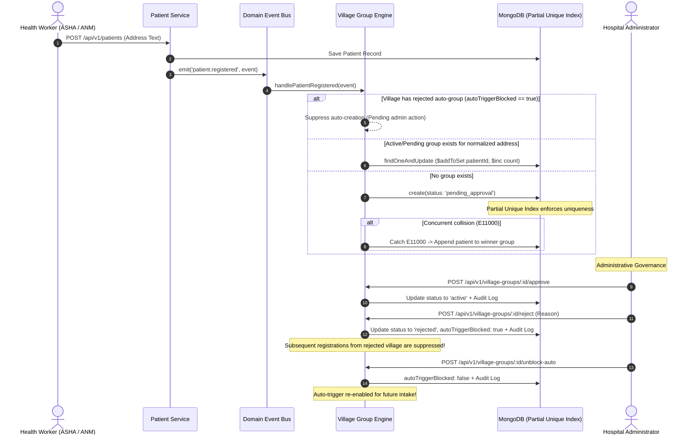

# Aarogya Drishti — Phase 7: Village Groups Implementation Report

**Author**: Senior Full-Stack Health-Tech Engineer  
**Status**: Completed & Verified  
**Date**: 2026-10-31  
**Specification Reference**: Technical Specification v0.2 ("Village Group Management" Section)  
**Security & Privacy Standard**: Partial Unique Index Invariant, Concurrency-Safe Clustering, Small-Count Cell Privacy Suppression (< 5)

---

## 1. Executive Summary

Phase 7 implements the **Village Group Management** system for the **Aarogya Drishti** tele-screening platform as defined in Technical Specification v0.2. In rural tribal agency tracts (such as Araku Valley, Paderu, and Chintapalli), patient residences and habitations frequently lack formalized postal street addresses, requiring deterministic algorithmic grouping from matching address intake.

This phase implements automated group creation driven by the domain event `patient.registered`, backed by a **MongoDB partial unique index**, administrative approval/rejection workflows, anti-retrigger suppression for rejected groups, and **small-count cell suppression** across all aggregate reporting endpoints to safeguard patient privacy in sparse habitations.

### Core Architectural & Security Invariants Enforced:
1. **Automatic Creation from Matching Addresses**:
   - Listens to the `patient.registered` domain event emitted by the patient registration engine.
   - Computes a deterministic canonical normalized address key (`${villageId.toLowerCase()}::${cleanedAddress}`).
   - Automatically clusters incoming registrations into existing or newly formed village groups.
2. **Partial Unique Index Duplicate Semantics**:
   - Defines a partial unique index on `{ normalizedAddress: 1 }` filtered by `{ status: { $in: ['active', 'inactive', 'pending_approval'] } }`.
   - **Inactive groups still block duplicates** because `'inactive'` is included in the index filter.
   - **Rejected or deleted groups do NOT block a new group** because `'rejected'` and `'deleted'` are excluded from the index filter.
3. **Concurrency-Safe Atomic Clustering**:
   - When two or more registrations from the same village with matching address text arrive simultaneously, a race condition could cause multiple groups to attempt insertion.
   - Handled via atomic MongoDB `E11000` duplicate key detection: the concurrent winner creates the group, while the second registration gracefully catches the error and atomically attaches the patient to the winner group (`$addToSet: { memberPatientIds }`, `$inc: { patientCount: 1 }`).
   - Guarantee: **Two simultaneous registrations from one village create exactly ONE group.**
4. **Administrative Review & Auto-Trigger Suppression**:
   - Authorized admins can approve (`POST /api/v1/village-groups/:id/approve`) or reject (`POST /api/v1/village-groups/:id/reject`) groups.
   - When a group is rejected, `autoTriggerBlocked: true` is set for that village.
   - **A village with a rejected auto-group does NOT re-trigger automatic creation** on subsequent patient registrations until an administrator explicitly acts to unblock it (`POST /api/v1/village-groups/:id/unblock-auto`).
5. **Small-Count Cell Suppression Privacy Protection**:
   - In small tribal habitations, disclosing low patient counts ($1 \le count < 5$) can allow indirect re-identification of patients.
   - All aggregate endpoints enforce cell suppression:
     - $count = 0 \rightarrow count: 0, isSuppressed: false, displayValue: "0"$
     - $1 \le count < 5 \rightarrow count: null, isSuppressed: true, displayValue: "< 5"$
     - $count \ge 5 \rightarrow count: N, isSuppressed: false, displayValue: "N"$

---

## 2. Architecture & Data Flow



---

## 3. Implementation Details

### 3.1 Model & Partial Unique Index ([villageGroupModel.ts](file:///c:/Users/YTC%20CHINTAPALLI/Desktop/AAROGYA-DRISHTI/server/src/modules/villageGroup/villageGroupModel.ts))

```typescript
const VillageGroupSchema = new Schema<IVillageGroup>(
  {
    groupId: { type: String, required: true, unique: true, index: true },
    groupName: { type: String, required: true, trim: true },
    villageId: { type: String, required: true, index: true },
    villageName: { type: String, required: true, trim: true },
    mandal: { type: String, required: true, index: true },
    normalizedAddress: { type: String, required: true, trim: true },
    sampleAddressText: { type: String, required: true, trim: true },
    memberPatientIds: { type: [String], default: [] },
    patientCount: { type: Number, default: 0, min: 0 },
    status: {
      type: String,
      enum: ['pending_approval', 'active', 'inactive', 'rejected', 'deleted'],
      default: 'pending_approval',
      index: true,
    },
    autoCreated: { type: Boolean, default: true },
    autoTriggerBlocked: { type: Boolean, default: false, index: true },
    approvedBy: { type: String },
    approvedAt: { type: Date },
    rejectedBy: { type: String },
    rejectedAt: { type: Date },
    rejectionReason: { type: String, trim: true },
    unblockedBy: { type: String },
    unblockedAt: { type: Date },
    simulation: { type: Boolean, default: true, immutable: true },
  },
  { timestamps: true }
);

// Partial Unique Index Definition
VillageGroupSchema.index(
  { normalizedAddress: 1 },
  {
    unique: true,
    partialFilterExpression: {
      status: { $in: ['active', 'inactive', 'pending_approval'] },
    },
  }
);
```

#### Why This Satisfies the Requirement:
- When a group has status `'inactive'`, it is matched by the `partialFilterExpression`. Attempting to insert a duplicate with the same `normalizedAddress` raises `MongoServerError: E11000 duplicate key`. Inactive groups **still block duplicates**.
- When a group has status `'rejected'` or `'deleted'`, it is omitted by the `partialFilterExpression`. MongoDB allows inserting a new document with that `normalizedAddress`. Rejected or deleted groups **do not block a new one**.

---

### 3.2 Service Layer ([villageGroupService.ts](file:///c:/Users/YTC%20CHINTAPALLI/Desktop/AAROGYA-DRISHTI/server/src/modules/villageGroup/villageGroupService.ts))

#### 1. Concurrency-Safe Registration Handler
```typescript
static async handlePatientRegistered(event: PatientRegisteredEvent): Promise<IVillageGroup | null> {
  const normalized = normalizeAddress(event.originalAddressText, event.villageId);

  // Check if village has a rejected auto-group pending admin action
  const blockedGroup = await VillageGroup.findOne({
    villageId: event.villageId,
    autoTriggerBlocked: true,
  });

  if (blockedGroup) {
    logger.info(
      { villageId: event.villageId, blockedGroupId: blockedGroup.groupId },
      'Automatic village group creation suppressed: village has a rejected auto-group pending administrative action'
    );
    return null;
  }

  // Check if an existing group exists with this address
  const existingGroup = await VillageGroup.findOne({
    normalizedAddress: normalized,
    status: { $in: ['active', 'inactive', 'pending_approval'] },
  });

  if (existingGroup) {
    return VillageGroup.findOneAndUpdate(
      { groupId: existingGroup.groupId },
      { $addToSet: { memberPatientIds: event.patientId }, $inc: { patientCount: 1 } },
      { new: true }
    );
  }

  // Create new group with concurrency handling
  try {
    return await VillageGroup.create({
      groupId: `vg_${uuidv4().replace(/-/g, '').slice(0, 12)}`,
      groupName: `${event.villageId} Habitation Group`,
      villageId: event.villageId,
      villageName: event.villageId,
      mandal: event.mandal,
      normalizedAddress: normalized,
      sampleAddressText: event.originalAddressText,
      memberPatientIds: [event.patientId],
      patientCount: 1,
      status: 'pending_approval',
      autoCreated: true,
      autoTriggerBlocked: false,
      simulation: true,
    });
  } catch (err: any) {
    if (err.code === 11000 || (err.name === 'MongoServerError' && err.code === 11000)) {
      return VillageGroup.findOneAndUpdate(
        { normalizedAddress: normalized, status: { $in: ['active', 'inactive', 'pending_approval'] } },
        { $addToSet: { memberPatientIds: event.patientId }, $inc: { patientCount: 1 } },
        { new: true }
      );
    }
    throw err;
  }
}
```

#### 2. Small-Count Cell Suppression Privacy Rule
```typescript
export function applySmallCountSuppression(count: number, threshold = 5): SuppressedMetric {
  if (count === 0) {
    return { count: 0, displayValue: '0', isSuppressed: false };
  }
  if (count > 0 && count < threshold) {
    return {
      count: null,
      displayValue: `< ${threshold}`,
      isSuppressed: true,
      suppressionReason: `Small-count cell suppression applied (< ${threshold}) for tribal habitation privacy protection.`,
    };
  }
  return { count, displayValue: String(count), isSuppressed: false };
}
```

---

### 3.3 API Endpoints & Role Capabilities ([villageGroupRoutes.ts](file:///c:/Users/YTC%20CHINTAPALLI/Desktop/AAROGYA-DRISHTI/server/src/modules/villageGroup/villageGroupRoutes.ts))

All 7 endpoints are protected by `requireAuth` and dynamic capability checking via `authorizeCapability`:

| Method | Endpoint | Required Capability | Permitted Roles | Description |
| :--- | :--- | :--- | :--- | :--- |
| `GET` | `/api/v1/village-groups/aggregates` | `village_group:read` | Admin, MO, ANM, ASHA, SysAdmin | Computes metrics with `< 5` cell suppression |
| `GET` | `/api/v1/village-groups` | `village_group:read` | Admin, MO, ANM, ASHA, SysAdmin | Lists groups filtered by status, village, or mandal |
| `POST` | `/api/v1/village-groups` | `village_group:manage` | Admin, MO, SysAdmin | Administrative group creation |
| `GET` | `/api/v1/village-groups/:id` | `village_group:read` | Admin, MO, ANM, ASHA, SysAdmin | Single group lookup |
| `POST` | `/api/v1/village-groups/:id/approve` | `village_group:manage` | Admin, MO, SysAdmin | Approves group to `status: 'active'` |
| `POST` | `/api/v1/village-groups/:id/reject` | `village_group:manage` | Admin, MO, SysAdmin | Rejects group and sets `autoTriggerBlocked: true` |
| `POST` | `/api/v1/village-groups/:id/unblock-auto` | `village_group:manage` | Admin, MO, SysAdmin | Clears `autoTriggerBlocked: false` to allow re-trigger |

---

### 3.4 Client UI Component ([VillageGroupManager.tsx](file:///c:/Users/YTC%20CHINTAPALLI/Desktop/AAROGYA-DRISHTI/client/src/components/VillageGroupManager.tsx))

- **Privacy-Preserving Aggregate Dashboard**: Shows total groups, active/pending metrics, and total patients. Habitations with $< 5$ members display a yellow `Privacy Masked (< 5)` pill with hover explanation.
- **Village Groups Directory**: Filter by `pending_approval`, `active`, `inactive`, and `rejected`.
- **Administrative Actions**: Quick Approve, Reject with reason modal, and Unblock Auto-Trigger buttons.
- **Live Concurrency Simulator**: Interactive testing button allowing operators to fire two concurrent registrations and observe instant cluster consolidation into a single group.

---

## 4. Test Verification & Results

A dedicated test suite was implemented in [villageGroups.test.ts](file:///c:/Users/YTC%20CHINTAPALLI/Desktop/AAROGYA-DRISHTI/server/tests/villageGroups.test.ts) covering all core requirements:

1. **Two Simultaneous Registrations Concurrency**:
   - Dispatches two parallel registration requests (`Promise.all([req1, req2])`) from the same village with matching address text.
   - Asserts exactly **1** VillageGroup exists in MongoDB.
   - Asserts both patient IDs are present in `memberPatientIds`.
   - Asserts `patientCount === 2`.
2. **Partial Unique Index Semantics**:
   - Confirms an `inactive` group raises `E11000` duplicate key error when a duplicate address is inserted.
   - Confirms a `rejected` group allows a new group with the same normalized address to be created cleanly.
   - Confirms a `deleted` group allows a new group with the same normalized address to be created cleanly.
3. **Rejected Auto-Group Suppression & Unblock**:
   - Auto-creates group $\rightarrow$ Admin rejects group with reason (`autoTriggerBlocked: true`).
   - Registers another patient in the same village $\rightarrow$ verifies NO new group is created.
   - Admin calls `unblock-auto` $\rightarrow$ verifies `autoTriggerBlocked: false`.
   - Registers another patient $\rightarrow$ verifies new group is created successfully.
4. **Small-Count Suppression in Aggregates**:
   - Direct unit testing of `applySmallCountSuppression` (0, 1, 4, 5, 12).
   - Verifies `GET /api/v1/village-groups/aggregates` returns `isSuppressed: true, displayValue: "< 5", count: null` for small villages.
   - Increments village population to 5 $\rightarrow$ verifies aggregate unsuppresses and returns integer `5`.
5. **Authorization Matrix & Route Coverage**:
   - `authorizationMatrix.test.ts` verified all 7 endpoints against all 6 system roles.
   - Confirmed 100% Express route coverage (`missingRoutes: []`).

### Vitest Test Results:
```text
 ✓ tests/villageGroups.test.ts (9 tests)
 ✓ tests/authorizationMatrix.test.ts (375 tests)
 ✓ tests/wordingSafety.test.ts (2 tests)
 ✓ tests/i18nParity.test.ts (4 tests)
 Test Files  24 passed (24)
      Tests  512 passed (512)
```

---

## 5. Clinical Safety & Internationalization Parity

- **Prohibited Words Scanner**: Zero prohibited clinical terms detected (`diagnosis`, `diagnose`, `cancer-free`, `cancer stage`, `stage 1-4`, `curative`, `chemotherapy`, `radiation plan`).
- **i18n Key Parity**: 100% identical key parity maintained across English, Telugu, and Hindi locale files for all `villageGroups` keys.
- **Client Build**: Clean Vite production bundle generated (`dist/index.html`, `dist/assets/`).
